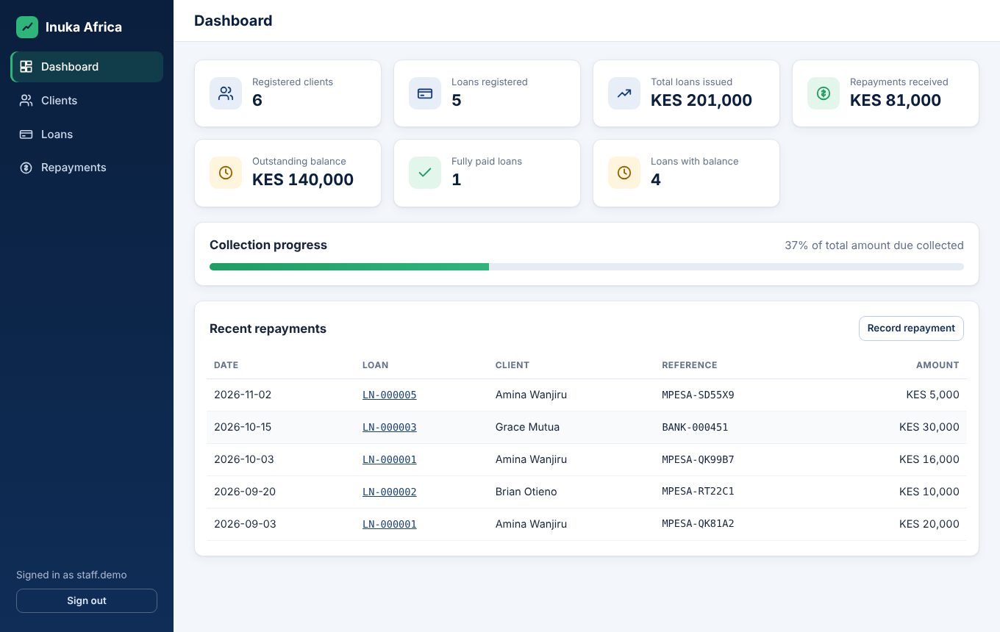
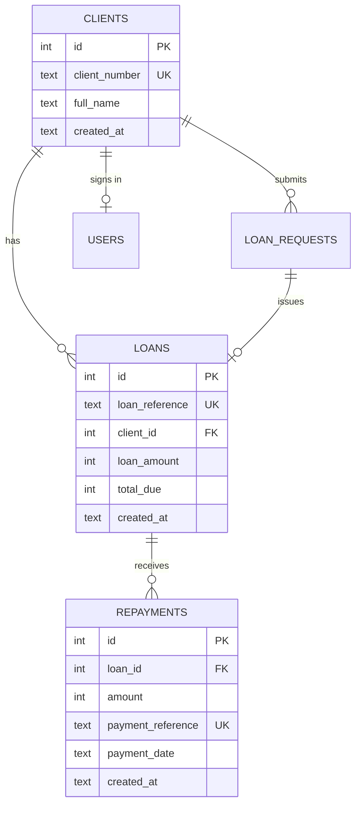

# Loan Track System

A small, practical web application for operations teams to **register clients, create loans, record repayments and see outstanding balances**.

> **Not production-ready for real customer data.** It has basic staff/client role separation (JWT + bcrypt), but no audit trail, backups, rate limiting, HTTPS or security review. See [Limitations](#limitations).



## Features
- Client registration with unique client numbers (auto-assigned or typed), search by name/number, client detail with their loans.
- Client self-registration with email sign-in, personal loan-request history, and a private view of their loans.
- Staff review of pending requests; approval creates a loan using staff-entered final terms, while rejection records an optional note.
- Staff-only CSV/Excel client import and export. Imports create accounts with one-time passwords that must be changed on first sign-in; exports never include passwords.
- Loans linked to clients, auto-generated unique reference (`LN-000001`), original amount + total due in KES, status **Outstanding / Fully Paid**.
- Repayments linked to loans with unique payment references, full history with running balance.
- Dashboard: clients, loans, total issued, total repaid, total outstanding, fully paid vs outstanding loans - all computed from the database.
- Responsive navy/white/green UI (desktop, tablet, phone), validation messages, loading spinners, success/error toasts.

## Tech stack
| Layer | Choice |
|---|---|
| Frontend | HTML5, CSS3, vanilla JavaScript (no framework, no build step) |
| Backend | Node.js 18+ and Express |
| Database | SQLite via `better-sqlite3` |
| Auth | JSON Web Tokens (`jsonwebtoken`) + `bcryptjs` password hashing; separate staff/client roles |
| API | REST, JSON |
| Tests | Node's built-in test runner + `supertest` |

Dependencies: `express`, `better-sqlite3`, `jsonwebtoken`, `bcryptjs`, `dotenv`, `exceljs` (+ `supertest` for tests).

## Quick start
Requires **Node.js 18 or newer** (`node -v`).

```bash
git clone <your-repo-url> loan-track-system
cd loan-track-system
npm install
npm run setup                                   # creates .env with a random JWT secret
npm run create-user -- yourname "a-strong-password"   # your staff login (min 8 chars)
npm run seed                                    # OPTIONAL: demo clients/loans/repayments
npm start                                       # http://localhost:3000
```
Open <http://localhost:3000> and sign in with the staff username you created. Clients can create accounts from the sign-in page using their email address. Data is stored in `data/inuka.db` and survives restarts.

From **Clients → Client spreadsheet**, staff can import `.csv` or `.xlsx` files with columns `Client number` (optional), `Full name`, `Phone number`, and `Email`. A matching client number updates the existing client record and links a new account; otherwise a client record and account are created. Imports are all-or-nothing and limited to 100 rows per file. Newly generated temporary passwords are shown once after a successful import; download and share them securely. Clients must change them on first sign-in. The CSV and Excel exports contain client numbers, names, phone numbers, and emails, never passwords.

| Command | What it does |
|---|---|
| `npm start` | Start the server |
| `npm run dev` | Start with auto-restart on file changes |
| `npm test` | Run all automated tests (in-memory database, your real data is never touched) |
| `npm run setup` | Create `.env` with a random `JWT_SECRET` |
| `npm run create-user -- <user> <pass>` | Add a staff login |
| `npm run seed` | Add demo data (only if the database is empty) |

Configuration (`.env`): `PORT`, `DB_FILE`, `JWT_SECRET`, `JWT_EXPIRES_IN`. See `.env.example`. No credentials are in the source code.

## Project structure
```
loan-track-system/
├── server.js                 # starts the app (opens DB, listens on PORT)
├── backend/
│   ├── app.js                # builds the Express app (middleware + routes)
│   ├── config.js             # reads environment variables
│   ├── db/
│   │   ├── schema.sql        # tables, constraints, indexes, trigger
│   │   └── database.js       # opens SQLite, enables foreign keys, runs schema
│   ├── routes/index.js       # HTTP endpoints (thin: call a service, send JSON)
│   ├── services/             # BUSINESS LOGIC + SQL (clients, requests, spreadsheets, loans, repayments, dashboard, auth)
│   ├── middleware/           # JWT check, central error handler
│   └── utils/                # validators, money parsing, error classes
├── frontend/                 # index.html, css/style.css, js/app.js
├── scripts/                  # setup-env, create-user, seed-demo
├── tests/                    # automated tests, including client portal and spreadsheet flows
└── docs/                     # API.md, WALKTHROUGH.md, DEMO_GUIDE.md, screenshots/
```
Layering: **routes** (HTTP) → **services** (rules + SQL) → **database**. Routes never contain business rules.

## Database design

(The `users` table stores staff and client logins with bcrypt hashes and roles. `loan_requests` records requested amounts, purposes, decisions, and the issued loan reference.)

**Relationships:** one client has many loans; one loan has many repayments. `loans.client_id → clients.id` and `repayments.loan_id → loans.id` are foreign keys (`ON DELETE RESTRICT`, so you cannot delete a client or loan that has history). `PRAGMA foreign_keys = ON` is set on every connection because SQLite does not enforce foreign keys by default.

**Constraints:** UNIQUE on `client_number`, `loan_reference`, `payment_reference`; CHECK `loan_amount > 0`, `total_due > 0`, `total_due >= loan_amount`, `amount > 0`, money columns must be `integer`. **Trigger** `trg_repayment_no_overpayment` rejects any repayment that would push total repaid above total due - a database-level backstop to the application check. **Indexes:** `loans(client_id)`, `repayments(loan_id, payment_date)`, `clients(full_name)` (UNIQUE columns are indexed automatically).

**No balance column exists.** `outstanding = total_due − SUM(repayments.amount)` is calculated on every read, so it can never drift out of sync.

## Key design decisions
- **Money is integer KES.** Whole shillings only, stored as INTEGER, validated as safe integers - no floating-point rounding errors. (Cents are not supported; extend by storing cents if ever needed.)
- **Total due is entered by staff.** The brief says not to assume interest or schedules, so the app does not calculate any. `total_due` is simply "the amount the client must repay in total" (≥ loan amount).
- **Repayment = one SQL transaction** (`BEGIN IMMEDIATE`): load loan → check unique reference → check balance → insert. If any step fails everything rolls back. `IMMEDIATE` takes the write lock first so two simultaneous payments cannot both overpay (tested).
- **Uniqueness enforced twice:** application pre-check for friendly messages + database UNIQUE constraint as the real guarantee. Codes are stored upper-case, so `mpesa-1` and `MPESA-1` are the same reference.
- **Frontend never sends balances.** It sends only the repayment details; the server recalculates everything. The "balance after this payment" preview in the form is cosmetic.
- **Errors:** expected problems return structured JSON (`{success:false,error:{code,message}}`) with proper status codes; unexpected errors are logged server-side and the user only sees a generic message.
- **Security:** parameterised SQL only, server-side validation, role-checked routes, clients can access only their own profile and requests, bcrypt hashes, forced first-login password changes for imported accounts, security headers + CSP, XSS-safe rendering (all dynamic text escaped), request size limit, no secrets in code.

## Tests
```bash
npm test
```
29 tests, including the **three mandatory scenarios** (`tests/scenarios.test.js`): successful repayment (10,000 − 3,000 = 7,000), duplicate payment reference, excessive repayment (1,500 against 1,000). Further tests cover invalid amounts, loan rules, database constraints, concurrency, authentication and authorization, client loan requests and decisions, temporary password changes, database migration, atomic CSV import, and CSV/Excel import and export.

## Documentation
- [API reference](docs/API.md)
- [Stage-by-stage walkthrough for learning](docs/WALKTHROUGH.md)
- [Demo guide & interview Q&A](docs/DEMO_GUIDE.md)
- Screenshots in [`docs/screenshots/`](docs/screenshots/)

## Troubleshooting
| Problem | Fix |
|---|---|
| `EADDRINUSE: port 3000` | Another program uses the port. Set `PORT=3001` in `.env`, or stop the other program. |
| `npm install` fails building `better-sqlite3` | Use Node 18/20/22 LTS (prebuilt binaries exist). On Windows install "Build Tools for Visual Studio" only if no binary is found. |
| Login says "session expired" after restart | `.env` is missing, so a temporary secret is used. Run `npm run setup`, restart. |
| `Incorrect username or password` | Create a user: `npm run create-user -- name "password"`. |
| Want a clean slate | Stop the server, delete `data/inuka.db*`, re-run `create-user` (and `seed`). |

## Limitations
No email verification or password-reset delivery; staff must hand imported-client temporary credentials to each client securely. No audit log of repayment changes; no editing/reversing of repayments (by design: financial records are append-only); no interest/penalty/schedule calculation; no rate limiting on login; single SQLite file with no automated backups; HTTP only (put behind HTTPS before any real use); tokens live in `sessionStorage`. Do not use with real customer data without addressing these and a security review.
